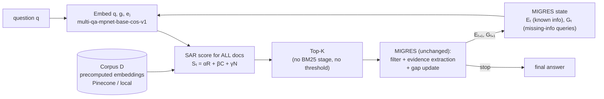

# SAR-MIGRES — State Aware Retrieval for iterative RAG

Implementation of the **State Aware Retrieval (SAR)** method from the thesis methodology
(*SAR: State Aware Retrieval for Iterative Retrieval Augmented Generation*), integrated into the
official **MIGRES** framework (Wang et al., COLING 2025; `github.com/AdelWang/MIGRES`).

> **Milestone: DESIGN + CORE IMPLEMENTATION.** This repository implements and tests the SAR scoring/retrieval
> core and the MIGRES integration layer. It contains **no experimental results**. Final evaluation, baseline
> comparison, Bayesian optimisation, ablations, RGB robustness and static-vs-dynamic weighting are
> **FUTURE / OCTOBER** work (interfaces only, disabled by default). The default weights (α, β, γ) and K in the
> configs are **development placeholders**, not tuned or optimal values.

## 1. What it does

At iteration *t* MIGRES holds a state *(q, Eₜ, Gₜ)*. SAR scores **every document in the corpus D** against that
state and returns the Top-K; MIGRES then filters/extracts evidence from those documents and updates the state.
Only the document-retrieval decision is replaced; MIGRES' prompts, filtering, evidence extraction, gap
generation and stopping rule are the upstream code.



## 2. SAR formulation (methodology Sec. 5.2, implemented verbatim)

```
cos(x,y) = φ(x)ᵀφ(y) / (‖φ(x)‖₂ ‖φ(y)‖₂)            s(x,y) = (1 + cos(x,y)) / 2  ∈ [0,1]
R(d,q)   = s(d,q)
C(d,Gₜ)  = (1/m) Σᵢ s(d,gᵢ)              ;  C = 0 if Gₜ = ∅
N(d,Eₜ)  = 1 − maxⱼ s(d,eⱼ)              ;  N = 1 if Eₜ = ∅
Sₜ(d)    = α R + β C + γ N               ;  α,β,γ ≥ 0,  α+β+γ = 1
Tₜ       = TopK_{d∈D} Sₜ(d)
```
Norms are computed explicitly (the formula never relies on the model returning unit vectors). Scoring is one batched
matrix product of the documents against the stacked `[q; Gₜ; Eₜ]` matrix (no |D|×|G|×|E| Python loops), chunked so
the corpus need not fit in one score matrix. Ties are broken by corpus order (deterministic). Zero vectors get cosine 0.

## 3. Relationship between MIGRES and SAR (and where SAR replaces the retriever)

| MIGRES (official `code/pipeline.py`) | This repo |
|---|---|
| `RetGBatched.search()` → `search_bm25()` (BM25 candidates) | **Replaced** by SAR full-corpus Top-K (`migres_adapter.py`, class `SARMigres.search`) |
| `Reranker.sentenceRerank()` (cross-encoder relevance filter, threshold δ=`--relevance`) | **Unchanged** (MIGRES' own filtering *after* Top-K; this is not a SAR threshold) |
| `QueryForward`, `promptMain/Leaf/Query`, `extractNewinfo`, stopping rule | **Unchanged** |
| `askGPT` → `send_post_request` (OpenAI client with empty credentials) | Transport swapped for `llm.py` providers (compat adapter, same prompts) |

**State mapping** (the methodology defines *(q, Eₜ, Gₜ)* but not which MIGRES variables they are; this is my interpretation —
please confirm it): `q` = the original question; `Eₜ = known_info[q]` (extracted useful information); `Gₜ` = the
sub-queries MIGRES generates for the missing information (`migres.gap_source: queries`; alternatives `missing_info`
= the free-text missing-info summary, or `both`); `G₀ = ∅` at the first retrieval.
Consequence: upstream BM25 ran one search *per* generated query; SAR runs **one** search per iteration with all queries in *Gₜ*.

Upstream is **not vendored and not modified**: `UpstreamCode` reads a local clone, extracts the needed definitions by
AST (records commit + SHA-256 of the files), and `SARMigres` subclasses the untouched `RetGBatched`, overriding only
`search` and `askGPT`.

## 4. Repository structure

```
configs/         default.yaml (thesis setup)  local.yaml (offline smoke test)  experiments.yaml (October plan, disabled)
data/            sample/ (synthetic corpus + 3 questions)   raw/ processed/ cache/ (git-ignored)   README.md
notebooks/       SAR_MIGRES_Execution.ipynb   (control panel; all logic is in src/)
src/sar_migres/  config, logging_utils(secret redaction), schemas, errors(+retry), embeddings, corpus, vector_store,
                 similarity, scoring, retrieval, migres_adapter, pipeline, llm, datasets, outputs, utils,
                 baselines / evaluation / optimization  (FUTURE interfaces)
scripts/         prepare_corpus  build_embeddings  run_single  run_batch  validate_installation
tests/           66 tests run with no credentials or network (2 more are optional: Gemini SDK stub test, real-MIGRES-clone integration test)
outputs/         runs/  tables/  logs/   (git-ignored)
```

## 5. Installation

**Python:** developed and tested on **3.12.3**. `requires-python >= 3.10`. The thesis lists Python 3.14.7; I could not
verify that the full real-run stack (torch, sentence-transformers, deepspeed-free MIGRES subset) has wheels/compat on 3.14 —
use 3.10–3.12 unless you have checked. Dependencies are *bounded ranges* (the thesis' exact versions of torch 2.13.0,
sentence-transformers 5.6.1, pinecone 9.1.0, bayesian-optimization 3.3.0 exist on PyPI and fall inside them; `pip --dry-run`
resolves the full set together).

```bash
python -m venv .venv && source .venv/bin/activate

# (a) OFFLINE smoke test + unit tests only (tiny, no downloads):
pip install -r requirements-offline.txt

# (b) REAL runs (Sentence Transformer + Pinecone + Gemini/OpenAI + official MIGRES filter):
pip install -r requirements.txt          # or:  pip install -e ".[all]"
```

## 6. Environment variables (never hard-code, never commit)

Copy `.env.example` → `.env` (git-ignored; scripts and notebook read it; values are never printed or logged — logs are redacted).

| Variable | Needed for |
|---|---|
| `PINECONE_API_KEY` | `vector_store.type: pinecone` (default) |
| `GEMINI_API_KEY` / `OPENAI_API_KEY` | `llm.provider: gemini` / `openai` |
| `OPENAI_BASE_URL` | optional OpenAI-compatible endpoint |
| `LLM_MODEL` | model id, if `llm.model` is empty. **No default on purpose**: use an id your provider offers |
| `MIGRES_REPO_DIR` | path to your clone of `AdelWang/MIGRES` |

The thesis names "Gemini 3.8 Flash". I could not confirm that exact id on Google's official docs (a third-party reseller lists
`gemini-3.8-flash`); check Google's models page and set `LLM_MODEL` yourself.

## 7. Corpus setup
See `data/README.md`. Short version: JSONL of `{"id","title","text"}` → `data.corpus_path`; question files per dataset
(WikiHop, HotpotQA, MuSiQue, Natural Questions, TriviaQA, StrategyQA — loaders in `datasets.py`). For a quick development
corpus: `python scripts/prepare_corpus.py --config configs/default.yaml --from-dataset hotpotqa data/raw/hotpot.json`
(built from per-question contexts — **not** the Wikipedia dump MIGRES uses).

## 8. Local smoke test (no API, no downloads)

```bash
pip install -r requirements-offline.txt
python -m pytest                                  # unit tests
python scripts/validate_installation.py           # environment report + offline end-to-end run
python scripts/run_single.py                      # one sample question, prints the per-iteration SAR trace
python scripts/run_batch.py                       # the 3 sample questions -> outputs/runs/<run_id>/
```
The offline path uses a **lexical hashing embedder**, a **rule-based fake LLM** and a **stand-in loop** (or, with
`--set migres.backend=upstream migres.repo_dir=/path/MIGRES`, the *real* upstream `RetGBatched` loop with the fake LLM and a
lexical stand-in for its cross-encoder filter). It validates plumbing and the scoring semantics; its answers and rankings are
meaningless and every output labels itself as such (`report.md` warnings, `metadata.json`).

## 9. Notebook

`notebooks/SAR_MIGRES_Execution.ipynb`: edit the block in **section 0** (`MODE`, `OVERRIDES`, `QUESTION`, `BATCH_LIMIT`) and
*Run all*. Sections: imports → config → key/dependency checks → corpus → embeddings → vector store → MIGRES adapter →
single question → per-iteration trace (gaps, evidence, doc ids, snippets, R/C/N, S) → batch → JSON/JSONL/CSV + report →
future modules (disabled). `MODE="local"` runs offline; `MODE="real"` uses `configs/default.yaml`.
It was executed end-to-end in a Jupyter kernel in `local` mode during development (0 error outputs); it ships with outputs cleared.

## 10. Real MIGRES + SAR run

```bash
git clone https://github.com/AdelWang/MIGRES.git ~/MIGRES         # not bundled
cp .env.example .env   # fill PINECONE_API_KEY, GEMINI_API_KEY (or OPENAI_API_KEY), LLM_MODEL, MIGRES_REPO_DIR
cp ~/MIGRES/data/hotpot.json data/raw/
python scripts/prepare_corpus.py --config configs/default.yaml --from-dataset hotpotqa data/raw/hotpot.json
python scripts/build_embeddings.py --config configs/default.yaml           # embeds -> Pinecone (+ local mirror)
python scripts/run_single.py --config configs/default.yaml --question "..."   # or omit --question
python scripts/run_batch.py  --config configs/default.yaml --limit 20
```
Interrupted batch: `python scripts/run_batch.py --config ... --run-id <id> --resume`.
Any setting can be overridden: `--set sar.alpha=0.5 sar.beta=0.3 sar.gamma=0.2 sar.k=5 llm.provider=openai`.

## 11. Outputs (`outputs/runs/<run_id>/`, tables also copied to `outputs/tables/`)

| File | Content |
|---|---|
| `config_snapshot.json` | full resolved config (env-var *names* only, no secret values) |
| `metadata.json` | run id, UTC times, seed, embedder, LLM provider+model, vector store, MIGRES backend + upstream commit/hashes, corpus path/size/**version hash**, embedding-sync report, package versions, warnings, peak RSS |
| `results.jsonl` | one record per question (final answer, status, error, MIGRES record) — appended as each question finishes |
| `traces.jsonl` | one record per SAR call: question, iteration, gaps, evidence, α/β/γ, K, retrieved docs (id, title, snippet, R, C, N, S, rank), docs scored, similarity count, embed/score/total seconds, MIGRES state transition (filter survivors, evidence added, next gaps) |
| `traces.csv` | the same, one row per (iteration, retrieved document) |
| `summary.csv` | one row per question |
| `report.md` | human-readable report incl. warnings |
| `logs/run.log` | redacted log |

## 12. Troubleshooting

| Symptom | Cause / fix |
|---|---|
| `MissingCredentialError: PINECONE_API_KEY…` | export it / fill `.env`, or `--set vector_store.type=local` |
| `ConfigError: LLM model name not configured` | set `llm.model` or `LLM_MODEL` |
| `UpstreamMigresError: … not found` | clone MIGRES, set `MIGRES_REPO_DIR` |
| warning "upstream files differ from tested version" | you use another MIGRES commit; behaviour unverified (`migres.strict_upstream_hash: true` to refuse) |
| `EmbeddingCacheCorruptionError` / "CACHE CORRUPT" | files are quarantined as `*.corrupt-<ts>` and rebuilt (`vector_store.on_cache_corruption: raise` to abort instead) |
| `StoreIncompatibleError` | cache/Pinecone was built with a different embedder; use `--rebuild` or another index/namespace |
| `ConfigError: embedding store is out of sync` | corpus changed; run `build_embeddings.py` |
| status `no_answer` | upstream MIGRES ended without `final_res` (e.g. no new info in the last iteration) — reported, not hidden |
| 429/timeouts | retried with jittered back-off (`llm.max_retries`); persistent failure marks that question `failed` |

## 13. Current milestone vs FUTURE (October)

| Implemented + tested now | Interfaces only / not run (FUTURE) |
|---|---|
| SAR scoring & full-corpus Top-K; simplex-constrained weights; incremental embedding maintenance; local + Pinecone stores; MIGRES adapter; LLM providers; dataset loaders (6 + RGB); outputs/reports; metric *formulas* (unit-tested on hand examples); BM25 + Sentence-Transformer-Search baselines (code only) | Running any benchmark; DPR / Contriever / SPLADE / ColBERTv2 (stubs raising `NotImplementedError`); Bayesian optimisation objective (`optimization.optimize_weights` exists, tested only on a toy function); static-vs-dynamic (dynamic rule is not specified in the methodology → not implemented); ablation runs; RGB protocols; cost study |

## 14. Research Implementation Mapping

| Methodology element | Module · function/class |
|---|---|
| Corpus embedding, fixed model (5.2.2, 5.4.2) | `embeddings.SentenceTransformerEmbedder`; `vector_store.sync_corpus_embeddings` |
| Persistent store (Pinecone) / local dev store | `vector_store.PineconeVectorStore` / `LocalVectorStore`; `build_vector_store` |
| New / changed / unchanged documents (5.2.2) | `corpus.Corpus.diff`, `vector_store.sync_corpus_embeddings` |
| State embedding φ(q), φ(gᵢ), φ(eⱼ) (5.2.3) | `retrieval.StateAwareRetriever.retrieve` (one batched call, memoised) |
| cos, s = (1+cos)/2 (5.2.4, Eq. 1) | `similarity.cosine_matrix`, `normalized_similarity_matrix` |
| R(d,q) (Eq. 2) | `scoring.question_relevance` |
| C(d,Gₜ), empty-gap case (Eq. 3–4) | `scoring.gap_coverage` |
| N(d,Eₜ), empty-evidence case (Eq. 5–6) | `scoring.evidence_novelty` |
| fused R/C/N computation | `scoring.score_components` |
| Sₜ and constraints (Eq. 7–8) | `scoring.sar_score`, `scoring.SARWeights` (`from_simplex` for optimisation) |
| Top-K over the complete corpus (Eq. 9) | `scoring.top_k_indices`, `retrieval.StateAwareRetriever.retrieve` |
| MIGRES state → SAR → MIGRES loop (Eq. 10) | `migres_adapter.UpstreamMigres` (`SARMigres.search`), `SARSearchProvider` |
| Static / dynamic weights (5.6.1) | `retrieval.StaticWeights` / `DynamicWeights` (dynamic = FUTURE) |
| Datasets (5.4.1) | `datasets.load_questions`; RGB: `datasets.load_rgb` |
| Baselines (Table 5.6) | `baselines.*` |
| Retrieval / iterative / answer / cost metrics (5.6.4–5.6.7) | `evaluation.*` (formulas only) |
| Bayesian optimisation (5.6.1) | `optimization.optimize_weights` |
| Ablations (5.6.3) | `evaluation.AblationStudy.ablation_weights` |
| Reproducibility (5.7) | `pipeline.SARMigresPipeline.metadata`, `utils.set_seed`, `config.Config.snapshot`, `Corpus.version` |

## 15. Compatibility decisions, deviations and limitations (please read)

1. **Upstream `pipeline.py` cannot be imported as-is** (argparse at import, module-level deepspeed/pyserini/faiss, and a syntax error at line 1104 in the inspected commit `1a67b87…`). The adapter extracts definitions via AST instead of editing upstream.
2. **`eval` → `ast.literal_eval`** inside the loaded upstream namespace (upstream `eval`s raw LLM text). Same result for valid literals; no code execution.
3. **Pinecone cannot compute exact SAR server-side** (ANN top-k only; SAR needs a full-corpus max over evidence). Pinecone is the durable store; scoring runs on an exact in-process mirror (optionally disk-cached, restored when vector counts match). Same code path as local mode.
4. **Embedded document text** = `"{title}. {text}"` (`embedding.embed_template`); the methodology doesn't specify it.
5. **Upstream flag differences:** `entail_judge` (T5-XXL NLI, ~11B params, on in upstream `migres.sh`) is **off** by default here; `num_process=1` (no multiprocessing); reranker default `BAAI/bge-reranker-base` (upstream's default string is `BAAI/bge-rerank-base`; neither could be verified offline). Upstream's `gpt_knowledge` fallback (`QueryForward`) is kept.
6. **`top_k` semantics:** SAR returns `sar.k` documents; upstream then places at most `migres.top_k` passages in a prompt after its own filter.
7. **Corpus maintenance** is explicit (`sync_corpus_embeddings`, run at `prepare()`); it is *not* automatically re-run at the end of each iteration as Sec. 5.2.2 describes (would require re-reading the corpus per iteration).
8. **Not verified here (no credentials / no network to HuggingFace):** real Sentence-Transformer embeddings, live Pinecone, live Gemini/OpenAI calls, the cross-encoder filter and the NLI model. Their code paths are covered by injected fakes (Pinecone index, OpenAI/Gemini clients) or were not executed. First real run may need small fixes.
9. Only **Python 3.12.3** was used for testing.
